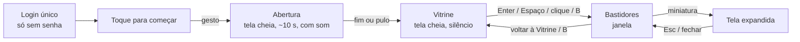

# BGS Sound Lab · Spine de experiência

Este arquivo define como o painel do home theater se comporta. A aparência está em [DESIGN.md](DESIGN.md), e os tokens aparecem aqui pelo caminho entre chaves, por exemplo `{colors.preto}`. Mocks de referência: [mockups/vitrine-keynote.html](mockups/vitrine-keynote.html) e [mockups/bastidores.html](mockups/bastidores.html). **Os spines vencem qualquer conflito com mocks, rascunhos ou imports.**

## Foundation

- **Superfície:** web de desktop no navegador do notebook, servida localmente em `http://127.0.0.1:8765` por `ferramentas/painel.py` (só biblioteca padrão), aberta por `painel.cmd`. Ela reformula `ferramentas/painel/index.html` e **preserva todas as funções** da [spec do painel](../../../implementation-artifacts/spec-painel.md).
- **A introdução antiga vira a abertura.** O nome "Denis Borges" continua em toda abertura (na assinatura). "Home Theater 2.1", "regulado por IA com guardião", o nome do processador e o firmware saem da tela cheia, porque são técnicos, e ficam no cabeçalho e na região Agora dos Bastidores. O avanço automático de 4 s deixa de existir: a Vitrine espera. **[ASSUMPTION]**
- **Offline:** HTML, CSS e JS inline, sem CDN, sem fonte baixada, sem arquivo de áudio. Tem que funcionar no sábado sem internet.
- **Sem framework de UI.** É um arquivo HTML com JS puro, sem build. Os tokens do DESIGN.md viram variáveis CSS.
- **Duas superfícies, uma página:**
  - **Vitrine:** tela cheia (Fullscreen API) na TV ou no projetor Wanbo T6 Max, em 16:9, para os convidados verem de longe.
  - **Bastidores:** janela normal maximizada no notebook, sem cobrir a barra de tarefas, só para o Denis.
- **A IA se chama KARINA** (homenagem à esposa do Denis), apresentada como "KARINA · Engenheira de Som". A marca continua "BGS Sound Lab by Denis Borges". Nos Bastidores, a região do agente se chama KARINA.
- **Dados:** `/api/estado` a cada 3 s (`montar_estado`). O redesenho acontece só quando algo mudou, para não perder rolagem nem fechar a tela expandida. `POST /api/ler` dispara a leitura, `POST /api/senha` faz o login único, e o novo `POST /api/modo` grava o modo ativo (ver [Modo ativo](#modo-ativo)). O painel **nunca escreve no processador**; o `/api/modo` só grava o campo `modo_ativo` de `estado/memorias.json`.
- **Áudio do navegador:** Web Audio API para sintetizar a abertura, e `getUserMedia` com `AnalyserNode` para ouvir a sala. As duas exigem gesto do usuário ou contexto seguro, e `127.0.0.1` conta como contexto seguro.

## Information Architecture

| Superfície | Como se chega | Para quê | Modo de janela |
|---|---|---|---|
| Login único | Abrir o painel **sem** `~/.taramps/senha` | Gravar a senha BT uma vez ("Denis" fixo, 4 caracteres, sem eco) | Janela |
| Toque para começar | Abrir o painel (depois do login, se houve) | O gesto que libera o som e a tela cheia | Janela, depois tela cheia |
| Abertura | Clique, Enter ou Espaço no "Toque para começar" | A apresentação audiovisual de cerca de 10 s, o único momento com som | Tela cheia |
| Vitrine (tela-título) | Fim ou pulo da abertura; "voltar à Vitrine"; tecla B nos Bastidores | A marca, a assinatura, o anel reagindo à sala e a linha humana com o modo | Tela cheia |
| Bastidores | Enter, Espaço, clique ou B na Vitrine; o ícone discreto dos Bastidores | Todas as funções do painel atual, mais a jornada do projeto | Janela maximizada |
| Tela expandida | Clique ou Enter numa miniatura dos Bastidores | Uma tela do app inteira, com todos os valores e a curva SVG | Sobreposição nos Bastidores |

A abertura toca **uma vez por carregamento da página**. Voltar à Vitrine não repete a abertura nem toca som. Recarregar a página começa de novo no "Toque para começar". **[ASSUMPTION]**

**Regiões dos Bastidores** (composição em [mockups/bastidores.html](mockups/bastidores.html)):

| Região | Conteúdo | Fonte |
|---|---|---|
| Cabeçalho | Marca pequena + "Bastidores"; chips: última leitura (data, hora, "há N min"), firmware, lidos/total, guardião (contagem de alertas), regra 6 ligada/desligada, microfone; "Ler agora"; "voltar à Vitrine" | `leitura`, `guardiao`, `leitor` |
| Agora (estado do aparelho) | Aparelho e firmware; os valores que importam em destaque (crossover, limiter em dB e V, ganhos, mute); a lista curta das violações do guardião, em frase humana | `leitura`, `telas`, `guardiao.violacoes` |
| Memórias | Os 3 slots do DSP e os presets do celular, com nome, origem (IA ou Denis) e data; o **seletor de modo** da Vitrine (Filme / Música SPL / Música EQ / nenhum) **[ASSUMPTION: posição na região Memórias]** | `memorias` (`estado/memorias.json`, incluindo `modo_ativo`) |
| KARINA (agente) + linha do tempo | O passo atual da regulagem (etapa, passo, "travou"); a linha do tempo dos ajustes (hora, lote, APROVADO/RECUSADO, aplicados, motivo da recusa, simulação); "escrevendo…" ou "lendo…" ao vivo | `agente.progresso`, `agente.ajustes`, `agente.em_andamento`, `leitor` |
| Jornada (feito × planejado) | Os marcos reais do projeto, separados em dois grupos | Conteúdo fixo desta spine (ver [Projeto em evolução](#projeto-em-evolução)) |
| 10 telas do app | Home, Roteamento, Alinhamento, Fase, EQ Param Entrada, Crossover, Limiter, Nível das Saídas, EQ Param Saída, EQ 15 Bandas, em miniatura, cada uma abrindo a tela expandida | `telas`, `curvas` |

Superfícies e jornadas fecham: cada superfície aparece em um dos [Key Flows](#key-flows). O login único é o passo 0 do Flow 2.

## Voice and Tone

Microcopy. A voz da marca está em DESIGN.md · Brand & Style.

**Vitrine: humana, zero jargão.** Quem lê é um convidado a três metros da TV.

| Faça | Não faça |
|---|---|
| "Som ajustado pela KARINA · Modo: Filme" | "DSP regulado por agente LLM com guardião" |
| "KARINA · Engenheira de Som" | "Assistente IA", "bot" ou "agente" na Vitrine |
| "em evolução" | "beta", "v0.1", "protótipo" |
| "by Denis Borges" | "Desenvolvido por", "© 2026" |
| "Toque para começar" | "Clique aqui para iniciar a experiência" |
| (nada) quando o microfone está desligado | "Microfone não autorizado" na TV |

**Bastidores: precisos, mas em português simples.** Quem lê é o Denis. Primeiro a frase, depois o código exato.

| Faça | Não faça |
|---|---|
| "Ganho da saída 1 voltou para −11 dB" + `081:0=-11.0` embaixo | Só `081:0=-11.0` |
| "O guardião recusou: desligar o passa-alta da saída 1 (JBL L)" | "REJECTED rule=1 item=042:0=0" |
| "Leitura de 16/10 às 17:47 · antiga" | "stale snapshot" |
| "lendo… 13 s" | "Aguarde, processando requisição" |
| "Processador não encontrado. O celular ainda está conectado a ele?" (mensagens atuais do `painel.py`) | Código de saída cru sem explicação |
| "Nenhuma memória registrada ainda" | "memorias.json ausente" |
| Decimal com vírgula na frase (0,56 V); ponto só dentro do código | Misturar os dois na mesma frase |

## Component Patterns

Comportamento. A especificação visual está em DESIGN.md · Components.

| Componente | Onde | Regras de comportamento |
|---|---|---|
| Toque para começar | Abertura do painel | Qualquer clique, Enter ou Espaço: `AudioContext.resume()`, pede a tela cheia no quadro e começa a abertura. Ignora outras teclas. Não toca nada antes do gesto. |
| Abertura | Tela cheia | Roda as 4 fases ([Abertura audiovisual](#abertura-audiovisual)). Qualquer tecla ou clique depois de `{motion.pular-abertura-apos}` pula: o som desce em `{motion.saida-suave}` (sem estalo) e a imagem vai direto ao quadro final. Antes de 1 s, entradas são ignoradas. |
| Anel de luz | Vitrine (e abertura) | Na abertura, segue o envelope do próprio som sintetizado (um `AnalyserNode` no barramento da abertura) **[ASSUMPTION]**. Na Vitrine, segue o microfone ([Reação ao som](#reação-ao-som)). Sem microfone, fica só o respiro ocioso. Nunca simula batida. |
| Linha da IA | Vitrine, abertura (fase 4) | "Som ajustado pela KARINA · Modo: {modo}". O modo vem de `memorias.modo_ativo.nome` ([Modo ativo](#modo-ativo)). Sem `modo_ativo` (ou com "nenhum"), mostra só "Som ajustado pela KARINA". A troca de modo aparece no próximo polling, com um esmaecimento de `{motion.transicao}` e sem som. |
| Selo "em evolução" | Vitrine | Estático, só o ponto pisca (`{motion.selo-piscar}`). Não é clicável. |
| Botão Bastidores | Vitrine | Clique ou foco + Enter vai aos Bastidores. Fica discreto (`components.botao-bastidores`). |
| Login único | Primeira abertura | Campo de 4 caracteres, sem eco, foco automático. Enter envia `POST /api/senha`. Tamanho ≠ 4: mensagem e nada gravado. Sucesso: segue para o "Toque para começar". Nunca mostra a senha. |
| Ler agora | Cabeçalho dos Bastidores | Clique: `POST /api/ler`. O botão fica desabilitado e mostra "lendo… N s" (contando). Ao terminar, mostra a mensagem do `painel.py` por alguns segundos e a leitura nova aparece. 409 (sem senha ou ajuste aberto) mostra o motivo. Sem leitura nenhuma, ganha destaque estático. |
| Voltar à Vitrine | Cabeçalho dos Bastidores | Clique ou B: tela cheia na Vitrine, **sem som e sem repetir a abertura**. |
| Chip de estado | Cabeçalho | Só informa, não é clicável. "há N min" é recalculado a cada polling. |
| Faixa de aviso | Topo dos Bastidores | Aparece com leitura antiga (> 60 min) ou incompleta e some sozinha quando a condição acaba. Não é fechável. |
| Item da linha do tempo | KARINA (agente) | Mais recente no topo, até 30 itens (`MAX_AJUSTES`), com rolagem própria. Cada item: hora, decisão, frase humana, código exato, "simulação" quando for. Recusa mostra o motivo do guardião. Um ajuste aberto (`em_andamento`) vira o primeiro item, com o ponto ao vivo. |
| Seletor de modo | Bastidores · Memórias | Quatro opções: Filme, Música SPL, Música EQ e nenhum. O clique envia `POST /api/modo` com o nome, e o servidor grava `modo_ativo` = {nome, por: "denis", hora}; "nenhum" apaga o campo. A opção ativa reflete o `/api/estado`, inclusive quando quem gravou foi a KARINA. Ao lado, a origem e a hora ("pela KARINA · 12:40"). Não escreve no processador; só muda o que a Vitrine diz. |
| Passo da regulagem | KARINA (agente) | Mostra "Etapa E · passo P de T" e a nota de retomada (`retomar.nota`, por exemplo "o mesmo passo: travou"). Só lê; quem avança é a `/regulagem`. |
| Slot de memória | Memórias | 3 slots fixos do DSP, mais a lista de presets do celular. Só lê `estado/memorias.json`. |
| Marco da jornada | Jornada | Estático. Feito e planejado em grupos separados. Nenhum planejado é desenhado como feito. |
| Miniatura de tela | 10 telas | Clique ou Enter abre a tela expandida. Tab percorre as 10 na ordem do app. "sem leitura" quando não há dados. |
| Tela expandida | Sobre os Bastidores | Abre em `{motion.expandir}` com `{motion.easing-entrada}`. Esc, "fechar" ou clique no véu fecham. O polling atualiza os valores **sem fechar**. Uma por vez, sem empilhar. Devolve o foco à miniatura de origem. |
| Curva SVG | Miniaturas e tela expandida | Redesenhada a partir de `curvas` a cada mudança no `/api/estado`. Escala log de 10 Hz a 22 kHz. Canal sem todos os valores fica sem curva (o servidor manda `None`), e a legenda diz "sem dados". Canais com curva idêntica (a ponte 3 e 4) desenham a 4 tracejada por cima da 3. Não é interativa. |
| Nota "microfone desligado" | Cabeçalho dos Bastidores | Aparece quando o microfone foi negado ou não existe. Clique pede a permissão de novo, se o navegador ainda permitir **[ASSUMPTION]**. |

## State Patterns

| Estado | Superfície | Tratamento |
|---|---|---|
| Sem senha guardada | Abertura do painel | Login único antes de tudo. Com o arquivo presente, o login nunca aparece. |
| Áudio indisponível (contexto não abre) | Abertura | A abertura roda sem som, com a mesma animação. Nada de aviso na tela cheia. |
| Movimento reduzido | Abertura, Vitrine | Ver [Accessibility Floor](#accessibility-floor). |
| Microfone ouvindo | Vitrine | O anel segue o grave da sala. Bastidores: chip "microfone ouvindo" **[ASSUMPTION]**. |
| Microfone negado ou indisponível | Vitrine, Bastidores | **Vitrine:** o anel respira devagar e de forma claramente calma (período de `{motion.anel-ocioso-periodo}`, ±1,5% no raio, sem ondas, sem deformação), sem nenhum texto. **Nunca finge reagir.** **Bastidores:** a pequena nota "microfone desligado" no cabeçalho. |
| Sala em silêncio | Vitrine | Com o microfone ouvindo, mas abaixo do limiar de ruído, o anel volta ao mesmo respiro ocioso. |
| Carregando (primeiro `/api/estado` ainda não voltou) | Bastidores | Regiões com os títulos e o conteúdo vazio, sem spinner e sem esqueleto animado; os dados entram de uma vez. **[ASSUMPTION]** |
| Tela cheia recusada pelo navegador | Abertura, Vitrine | A abertura roda na janela mesmo assim; "voltar à Vitrine" tenta de novo no próximo clique. **[ASSUMPTION]** |
| Sem leitura ainda | Bastidores | Miniaturas "sem leitura", Agora com "Nenhuma leitura ainda", "Ler agora" em destaque estático. Chips de leitura ocultos. |
| Leitura antiga (> 1 h) ou incompleta | Bastidores | Faixa de aviso: "Leitura de 16/10 às 17:47 · antiga" ou "· incompleta (N de 84)". Chip da leitura com ponto de luz quente. Os valores continuam visíveis. |
| Lendo (Ler agora em curso) | Bastidores | Botão desabilitado com "lendo… N s"; linha da KARINA com "lendo…" e ponto ao vivo. Ao fim, a mensagem do resultado (ok ou motivo). |
| KARINA escrevendo | Bastidores | O primeiro item da linha do tempo mostra "escrevendo 081:0=-12.0…" com o ponto ao vivo. Some quando o registro fecha; um "em andamento" parado há mais de 10 min vira "interrompido?". |
| Recusa do guardião | Bastidores | Item RECUSADO com o motivo em frase ("desligar o passa-alta da saída 1 (JBL L)"), o código e a regra ("trava 1"). Não toca alarme, não pisca: a recusa é o sistema funcionando. |
| Violações na leitura atual | Bastidores · Agora | Lista curta das violações do guardião, em frase. Contagem no chip do guardião. |
| Sem memórias registradas | Bastidores · Memórias | 3 slots vazios e "Nenhuma memória registrada ainda. A /regulagem registra cada uma ao salvar." |
| `memorias.json` ilegível | Bastidores · Memórias | Slots vazios + "Não consegui ler as memórias." O resto do painel segue. |
| Sem modo registrado | Vitrine, Bastidores | **Vitrine:** a linha omite o modo e fica só "Som ajustado pela KARINA". **Bastidores:** o seletor marca "nenhum", sem origem. |
| Modo registrado | Vitrine, Bastidores | **Vitrine:** "Som ajustado pela KARINA · Modo: Filme". **Bastidores:** o seletor marca a opção, com "pela KARINA" ou "pelo Denis" e a hora. Vale a última gravação, venha de onde vier. |
| `POST /api/modo` falha | Bastidores | O seletor volta à opção anterior e mostra embaixo "Não consegui gravar o modo." A Vitrine não muda. |
| Sem progresso de regulagem | Bastidores · KARINA | "Regulagem ainda não começou." |
| Seção com dado estranho | Bastidores | Cada seção degrada sozinha (`problemas[]`); as outras continuam. |
| Servidor local parado (polling falha) | Vitrine, Bastidores | **Vitrine:** nada muda na tela; mantém o último modo. **Bastidores:** faixa de aviso "Sem conexão com o painel local. Tentando de novo." Some no próximo polling bom. **[ASSUMPTION]** |
| Offline (sem internet) | Tudo | É o estado normal: nada depende de rede além do `127.0.0.1`. |
| Tela expandida aberta durante o polling | Bastidores | Valores atualizam no lugar; a tela não fecha nem rola. |
| Tela expandida sem dados | Bastidores | Mesma tela com "sem leitura" no lugar da tabela e da curva. |

## Interaction Primitives

| Entrada | Toque para começar | Abertura | Vitrine | Bastidores | Tela expandida |
|---|---|---|---|---|---|
| Enter / Espaço | Começa | Pula (após 1 s) | Vai aos Bastidores | Ativa o foco | Ativa o foco |
| Clique | Começa | Pula (após 1 s) | Vai aos Bastidores | Normal | Fora do quadro fecha |
| Esc | — | Pula (o navegador também sai da tela cheia) | Sai da tela cheia e vai aos Bastidores **[ASSUMPTION]** | — | Fecha |
| B | — | Pula | Vai aos Bastidores | Volta à Vitrine (tela cheia, sem som) | Fecha e volta à Vitrine |
| Ícone discreto | — | — | Ícone dos Bastidores, canto inferior direito | "voltar à Vitrine" no cabeçalho | — |
| Tab | — | — | Só o ícone dos Bastidores recebe foco | Ordem de leitura: cabeçalho → Agora → KARINA → Memórias → Jornada → 10 telas | Preso dentro da tela expandida |

A Vitrine só existe em tela cheia. Sair da tela cheia por qualquer caminho leva aos Bastidores, nunca a uma Vitrine em janela. **[ASSUMPTION]**

Proibido: som em qualquer interação depois da abertura (clique, hover, aviso, erro); tela expandida sobre outra tela expandida; atalhos que escrevam no processador.

## Accessibility Floor

Comportamento. Contraste visual está em DESIGN.md · Colors.

- **`prefers-reduced-motion: reduce`:** a abertura cai para `{motion.abertura-reduzida}`, um esmaecimento direto para a composição final, só com a fase 4 (o sting) no mesmo teto de volume **[ASSUMPTION]**. Os pulsos ficam desligados: anel parado (sem respiro, sem ondas, sem deformação), ponto do selo fixo, ponto ao vivo fixo, "Ler agora" sem halo animado.
- **Abertura pulável** com qualquer tecla ou clique depois de `{motion.pular-abertura-apos}`.
- **Som:** nunca mais alto que cerca de −12 dBFS ([Abertura audiovisual](#abertura-audiovisual)), nunca fora da abertura, nunca sem gesto.
- **Sem informação só por cor:** APROVADO/RECUSADO, antiga/incompleta e os canais (número sempre junto da cor) levam palavra ou número.
- **Foco visível** em tudo que é clicável nos Bastidores (fio branco a 45%, `components.miniatura-tela.borda-foco`). As miniaturas são botões de verdade, acionáveis por Enter.
- **Tela expandida:** `role="dialog"`, foco preso dentro, Esc fecha, o foco volta à miniatura.
- **Leitura à distância** na Vitrine: o menor texto (selo) tem 16,5 px a 1920 px de largura, e todo o resto é maior.
- **Texto mínimo** nos Bastidores: 12,5 px só em rótulos; o corpo começa em 14 px.
- **`aria-live="polite"`** no resultado do "Ler agora" e no item "escrevendo…".
- **Contraste:** texto ≥ 4,5:1, conforme DESIGN.md (o cinza 2 nunca em texto pequeno).

## Key Flows

### Flow 1 · A inauguração (Denis, sábado 17/10, sala cheia de convidados)

1. O home theater está ligado. O notebook do Denis está conectado ao processador e à TV, ou ao projetor Wanbo T6 Max. Os convidados estão no sofá.
2. O Denis dá dois cliques em `painel.cmd`. O navegador abre no "Toque para começar": preto, um ponto de luz e a frase. A senha já está gravada, então não há login.
3. Ele pressiona Enter. A tela vai para tela cheia e a sala escurece na TV.
4. **Fase 1:** um ponto de luz acende no centro e um grave misterioso cresce baixinho pelo sistema.
5. **Fase 2:** o ponto se abre num anel que se expande e ganha cor fria, lilás e quente. Camadas de som sobem em intensidade.
6. **Clímax:** "**BGS** Sound Lab" sai do desfoque **junto com o impacto sonoro**: um sub que bate no peito, uma explosão de brilho e uma reverberação larga que enche a sala. É o momento do "uau".
7. **Fase 4:** "by Denis Borges" e "Som ajustado pela KARINA · Modo: Filme" (o modo que a KARINA registrou ao carregar a memória FILME) aparecem com o sting final. O som some até o silêncio.
8. Fica a Vitrine. O Denis põe uma música. O anel passa a respirar com o grave **de verdade**, pelo microfone do notebook. Alguém pergunta "que som é esse?!" e ele aponta para a assinatura.
9. Um convidado quer saber como funciona. O Denis pressiona Enter: a tela cheia se fecha e os Bastidores abrem em janela, com a jornada do projeto. Ele mostra o que está feito e o que está planejado.
10. Para voltar ao clima, ele clica em "voltar à Vitrine" (ou pressiona B). A Vitrine volta em tela cheia, **sem som e sem repetir a abertura**.

Falhas:
- **Microfone negado ou ausente:** no passo 8, o anel só respira devagar, claramente em repouso. Nada aparece na TV. Nos Bastidores, a nota "microfone desligado".
- **Abertura sem som** (o áudio do navegador não abriu): a animação roda igual. O Denis pode recarregar para tentar de novo.
- **Pressa:** no passo 4, depois de 1 s, qualquer tecla pula direto para a Vitrine.
- **Leitura antiga:** a Vitrine não muda nada. Nos Bastidores, a faixa "antiga" lembra o Denis de clicar em "Ler agora".

### Flow 2 · A regulagem com a KARINA (Denis sozinho, sábado a partir das 12h)

0. **Primeira vez neste notebook:** sem `~/.taramps/senha`, o painel abre no login único. O Denis digita a senha de 4 caracteres (sem eco) e o painel segue para o "Toque para começar". Senha com tamanho errado volta com mensagem e nada é gravado.
1. Antes dos convidados, o Denis abre o painel e vai direto aos Bastidores: pula a abertura depois de 1 s e pressiona Enter na Vitrine. Na primeira vez, autoriza o microfone pela nota do cabeçalho. **[ASSUMPTION]**
2. A faixa diz "Leitura de 16/10 às 17:47 · antiga". Agora mostra as 5 violações do guardião (JBL L e R com passa-alta BT12 em 150 e 120 Hz; subsônico em 28 Hz nas saídas 3 e 4; attack diferente na ponte, 50,0 × 50,1 ms). A região KARINA mostra "Etapa 0 · passo 2 de 3 · o mesmo passo: travou".
3. Ele fecha o app do celular e clica em "Ler agora". O botão mostra "lendo… 13 s" e a leitura nova chega. A faixa some.
4. Na outra janela, ele chama `/regulagem`. A KARINA conduz a etapa 2 (correções) e propõe um lote.
5. Nos Bastidores, o topo da linha do tempo mostra o ponto ao vivo e "escrevendo 042:0=…" enquanto o ajuste está aberto.
6. **Clímax:** o item fecha com **APROVADO**, a frase em português do que mudou e o código exato embaixo, com os aplicados conferidos pela releitura. No próximo "Ler agora", a contagem do guardião cai. O Denis vê a KARINA trabalhar sem abrir o app do celular.
7. Ele clica na miniatura Crossover. A tela expandida mostra as quatro curvas na escala log, já com os cortes novos. Esc fecha e o foco volta à miniatura.
8. Quando a etapa 5 ou 6 salva uma memória pelo app, a `/regulagem` a registra e o slot aparece em Memórias com nome, "IA" ou "Denis" e a data. A KARINA também roda `sessao.py modo "Filme"`, e o seletor passa a marcar Filme "pela KARINA". Na TV, a linha vira "Som ajustado pela KARINA · Modo: Filme".
9. Antes de pôr música para os convidados, o Denis clica em "Música SPL" no seletor. O `POST /api/modo` grava o modo "pelo Denis", e a Vitrine troca a linha no próximo polling, sem som.

Falhas:
- **Recusa do guardião:** o item vem RECUSADO com o motivo em frase ("desligar o passa-alta da saída 1 (JBL L)"), a regra (trava 1) e o código. Nada é escrito. O Denis segue a sugestão segura da `/regulagem`.
- **Ler agora falha:** a mensagem curta do `painel.py` ("Processador não encontrado. O celular ainda está conectado a ele?") aparece embaixo do botão, que volta a ficar ativo.
- **Ler agora durante um ajuste aberto:** 409 com a mensagem atual do `painel.py`, "o agente está ajustando o aparelho; espere acabar", e o botão continua ativo.
- **Processo do ajuste morreu:** depois de 10 min sem atualização, o item vira "interrompido?" e o ponto ao vivo some.

## Abertura audiovisual

O único momento com som em todo o produto. Começa só depois do gesto no "Toque para começar" e nunca mais toca nessa carga da página.

**Regras:**

- **Só síntese Web Audio:** osciladores, ruído gerado em buffer, filtros, envelopes e um `ConvolverNode` com resposta ao impulso gerada no código (ruído com decaimento). **Sem música, sem arquivos de áudio, sem rede.**
- **Teto de cerca de −12 dBFS** no pico, porque o som sai pelo home theater (notebook → processador → amplificação). Cadeia final: `GainNode` mestre → `DynamicsCompressorNode` como limitador (limiar −12 dB, razão 20:1, ataque de 3 ms) → `destination`. O limitador do processador é a segunda camada.
- **Exige gesto:** o `AudioContext` é criado ou retomado no clique ou na tecla do "Toque para começar".
- **Pular:** depois de `{motion.pular-abertura-apos}`, qualquer tecla ou clique leva o mestre a zero em `{motion.saida-suave}` e fecha o contexto. O microfone só abre depois disso.
- **Nunca depois:** nenhum som em interações, avisos, erros, volta à Vitrine ou Bastidores.
- **Duração total:** `{motion.abertura-duracao}`. Com movimento reduzido, `{motion.abertura-reduzida}`.

**Linha do tempo** (o storyboard de 6 s do mock Keynote, em [mockups/vitrine-keynote.html](mockups/vitrine-keynote.html), esticado para as 4 fases de som decididas; ~10 s):

| Tempo | Fase | Imagem | Som (Web Audio) |
|---|---|---|---|
| 0,0–2,0 s | 1 · Início | Preto total; um ponto de luz acende devagar no centro do anel | Drone grave baixo (seno ~45 Hz + oitava, filtro passa-baixa) que cresce do silêncio; brilho distante (senos agudos fracos, leve desafinação) |
| 2,0–5,5 s | 2 · Construção | O ponto se abre num anel que se expande, ganha a luz fria, lilás e quente e começa a girar | Riser de ruído filtrado (passa-banda subindo), pulsos que aceleram, shimmer em camadas, intensidade crescente |
| 5,5–7,0 s | 3 · Clímax | Em ~5,8 s, "**BGS** Sound Lab" sai do desfoque; o anel dá um pulso de brilho e solta uma onda | Impacto sub (seno caindo de ~60 para ~30 Hz), explosão de brilho (ruído passa-alta curto) e reverberação larga (convolver), tudo sincronizado com a revelação do nome |
| 7,0–10,0 s | 4 · Finalização | "by Denis Borges" e a linha da IA aparecem em ~7,4 s; o anel assenta | Assinatura sonora curta e elegante (sting de duas ou três notas tipo sino ou FM) em ~7,6 s, decaindo até o silêncio em 10 s |
| 10,0 s → | Vitrine | Composição final; o anel passa ao microfone (ou ao respiro ocioso) | Silêncio, para sempre nessa sessão |

Os tempos internos de cada fase são **[ASSUMPTION]**: as 4 fases, a ordem, a duração de ~9–10 s e o clímax na revelação do nome estão decididos; os segundos exatos são ponto de partida para ajuste no ouvido.

## Reação ao som

A Vitrine reage à música **de verdade**, pelo microfone do notebook. A animação decorativa que não acompanha a música foi rejeitada: seria efeito de mentira.

- **Captura:** `navigator.mediaDevices.getUserMedia({ audio: { echoCancellation: false, noiseSuppression: false, autoGainControl: false } })` em `127.0.0.1`, que é contexto seguro **[ASSUMPTION: restrições que não matem o grave]**. A fonte vai para um `AnalyserNode` (`fftSize` 2048, suavização própria) e **nunca** para `destination`: o microfone só escuta e não toca nada.
- **Quando abre:** só depois que a abertura terminou ou foi pulada. Assim o anel não reage ao próprio som da abertura pelo microfone, e o som da abertura não alimenta o microfone.
- **Permissão, uma vez:** o navegador pergunta uma vez e lembra para `127.0.0.1:8765`. Para não aparecer caixa do navegador na frente dos convidados, a Vitrine só chama `getUserMedia` se `navigator.permissions.query({name:'microphone'})` já estiver `granted`. Senão, fica no respiro ocioso. O pedido de permissão parte dos Bastidores (nota do microfone), antes da festa. **[ASSUMPTION]**
- **O grave dirige o anel:** a energia da faixa de ~20–150 Hz controla o raio (até +7,5%) e o brilho do halo, com ataque `{motion.anel-ataque}` e soltura `{motion.anel-soltura}`. Médios e agudos deformam o contorno de leve. Um pico de grave acima da média recente solta uma onda fina. A lógica de desenho é a do mock; ali o sinal é **simulado**, e no app ele vem do microfone.
- **Limiar de ruído:** abaixo dele, o anel volta ao respiro ocioso.
- **Ocioso:** respiro lento (`{motion.anel-ocioso-periodo}`, ±1,5% de raio, brilho quase constante, sem ondas, sem deformação). Ele tem que parecer **claramente calmo**, diferente da reação à música.
- **Movimento reduzido:** anel parado, sem reação.
- **Fase 2 do projeto não é isto:** aqui o microfone é só para a luz. Medição e equalização automática com microfone ficam planejadas ([Projeto em evolução](#projeto-em-evolução)).

## Projeto em evolução

A região Jornada dos Bastidores mostra o projeto como ele é: o que **está feito e provado** e o que **está planejado**. Ela não sugere que o projeto está concluído. Na Vitrine, isso aparece só como o selo "em evolução". O conteúdo é fixo, revisado à mão a cada marco **[ASSUMPTION: onde ele fica no código]**, e só entram fatos com evidência em commit, mapa ou estado:

**Feito**

| Marco | Evidência |
|---|---|
| Protocolo BLE do PRO 2.4BT decifrado pelo APK (mapa v1) | `protocolo/MAPA.md`, commit `f5918ab` |
| Leitura pelo notebook: 84 de 84 parâmetros, cerca de 13 s, firmware R003 (16/10) | `estado/leituras/2026-10-16_1747.json`, `_1806.json` |
| Conferência com o app: 34 de 34 no estado atual e 33 de 34 na memória FILME (a diferença foi o próprio app reescrevendo o limiter em Auto) | `protocolo/MAPA.md` §9 |
| Escrita com guardião provada no aparelho real: ganho da saída 1 para −12,0 dB e de volta para −11,0, conferido pela releitura (16/10, 20:21–20:22) | `estado/ajustes/2026-10-16_2021-2.json`, `_2022.json`; commit `cefa045` |
| O guardião recusou a trava 1: desligar o passa-alta da saída 1 (JBL L), em simulação (16/10, 20:21) | `estado/ajustes/2026-10-16_2021.json` |
| `/regulagem`: facilitadora com roteiro em 9 etapas, progresso e diário | commit `86f8d03` |
| Painel local com login único e as 10 telas do app | commit `393a83e` |

**Planejado**

| Marco | Origem |
|---|---|
| Regulagem de sábado (17/10, das 12h às 17h), retomando na etapa 0, passo 2 | `estado/sessoes/progresso.json` |
| Fase 2: microfone e equalização automática, mais a verificação do mapa de canais por medição | `SPEC.md` (fora de escopo da fase 1) |
| MCP como evolução depois do sábado | `forged-idea.md` |
| Apresentar à Taramps (pitch) | `SPEC.md` |

Regra: um marco passa de "planejado" para "feito" só com evidência nova. Nada fictício, nada arredondado para cima.

## Modo ativo

O "Modo" da linha da Vitrine diz qual ajuste está tocando, numa palavra que o convidado entende. É **declarado**, não lido do aparelho: o protocolo não diz qual memória está carregada.

| Origem | Como grava | `por` |
|---|---|---|
| Automática | Quando a KARINA (`/regulagem`) salva ou carrega uma memória, ela roda `sessao.py modo "<Filme · Música SPL · Música EQ>"` | `ia` |
| Manual | Seletor nos Bastidores → `POST /api/modo` com o nome, ou com "nenhum" para apagar | `denis` |

- **Campo:** `estado/memorias.json` → `modo_ativo: {nome, por, hora}`. Vale a última gravação, de qualquer origem. Sem o campo, a linha omite o modo.
- **Nomes aceitos:** só "Filme", "Música SPL" e "Música EQ". Nada técnico vai para a TV.
- **Escopo:** isto é só especificação de experiência. `sessao.py modo` e `POST /api/modo` ainda não existem, e esta mudança não traz código. O `POST /api/modo` é a primeira rota do painel que escreve dentro de `estado/`; a docstring e a spec do painel, que hoje dizem que o servidor só lê `estado/`, precisam acompanhar.

## Responsive & Platform

| Contexto | Comportamento |
|---|---|
| TV ou projetor, tela cheia | A Vitrine ocupa a tela inteira. A composição escala pela largura do quadro (`cqw`). Fora de 16:9, o quadro centraliza com faixas pretas. |
| Notebook a 1920 px | Bastidores com cabeçalho, 3 colunas e as 10 miniaturas em uma linha ([mockups/bastidores.html](mockups/bastidores.html)). |
| Notebook a 1366 px (piso) | 2 colunas (Jornada desce) e miniaturas em 5 + 5. **[ASSUMPTION]** |
| Navegador | Chrome ou Edge no Windows (Fullscreen API, Web Audio, getUserMedia, Permissions API). |

## Inspiration & Anti-patterns

- **Herdado de lançamentos Apple e Bang & Olufsen:** o preto absoluto, a luz como estrela, a tipografia enorme e fina, quase nada na tela.
- **Herdado de aberturas de console e jogos AAA:** o "toque para começar" como gesto de entrada, a abertura em tela cheia com crescendo sonoro e a tela-título estática, mas viva.
- **Herdado do app Taramps:** só o desenho das 10 telas e o mapeamento de cor dos canais, nos Bastidores.
- **Rejeitado: as três direções técnicas** (Rack Âmbar, Bancada de Medição, Vidro Negro). Quem olha não quer saber o que o sistema faz; quer saber que o Denis fez, que tem uma IA e que é dele.
- **Rejeitado: animação decorativa que imita reação ao som.** Seria efeito de mentira.
- **Rejeitado: música na abertura e qualquer som depois dela.**
- **Rejeitado: números técnicos na Vitrine.**
- **Os mocks antigos que ficam para trás:** o texto "simulação do mock", o aviso "no app real pede o login do Denis" e a linha "Som ajustado por inteligência artificial" no mock da Vitrine estão superados. A linha agora é "Som ajustado pela KARINA". Os Bastidores não pedem login; o login único só existe sem senha guardada.

## Pendências

- Resolvidas em 17/10: a origem do "Modo" ([Modo ativo](#modo-ativo)) e o nome da IA (KARINA · Engenheira de Som). Não há pendências de decisão abertas; as **[ASSUMPTION]** marcadas no texto continuam valendo até o Denis dizer o contrário.
